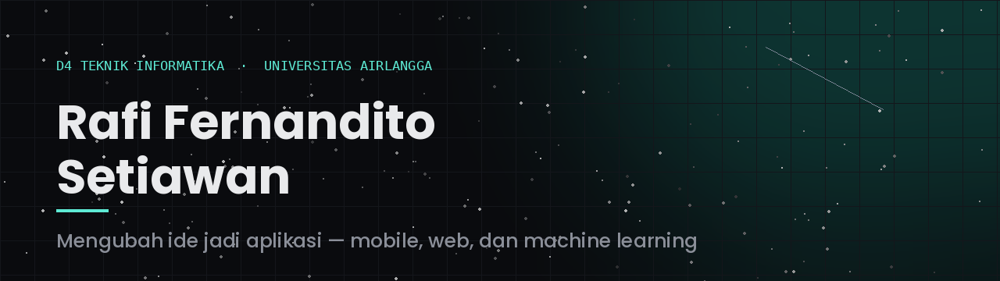
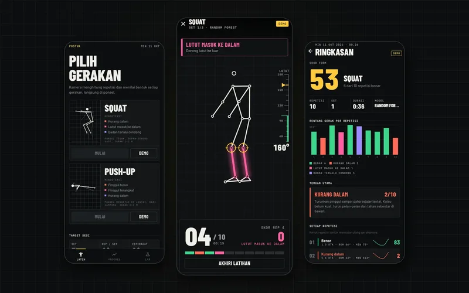
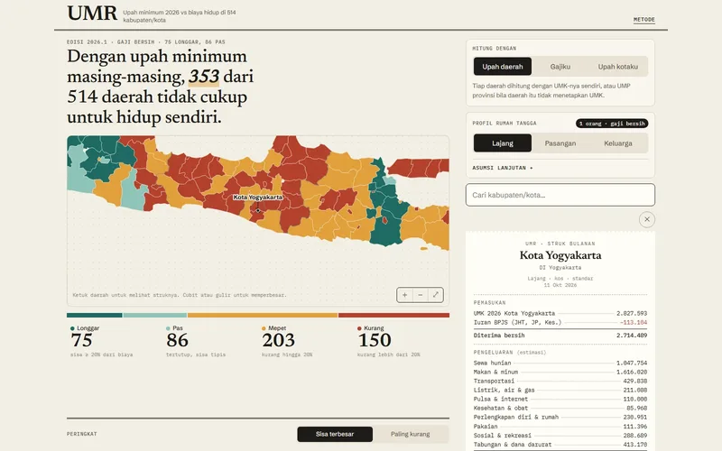
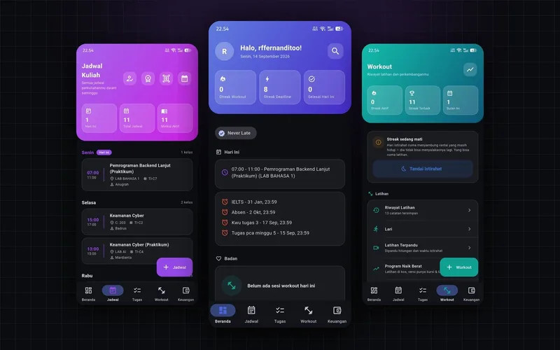
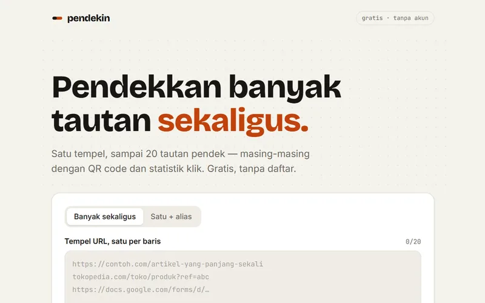
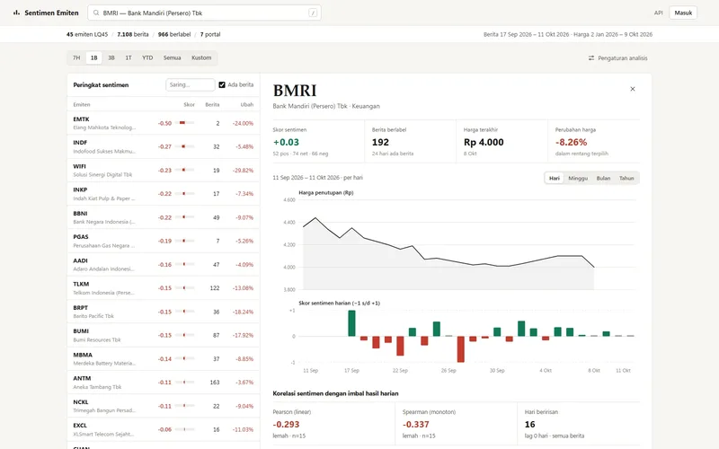
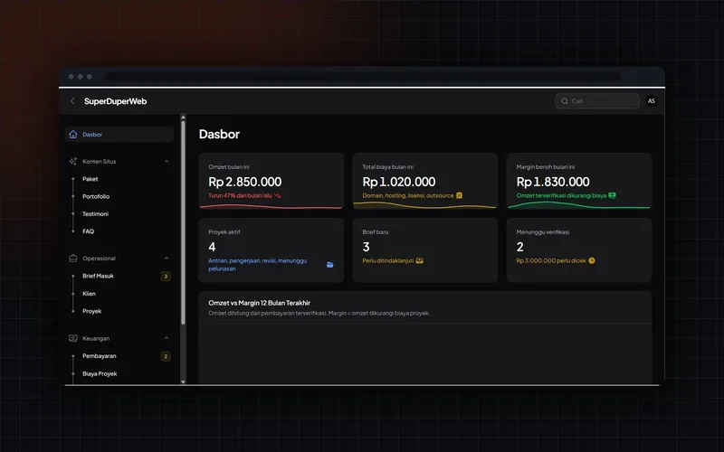

<div align="center">



<br/>

<a href="https://www.raffstw.my.id"></a>
<a href="https://www.linkedin.com/in/rafi-fernandito-setiawan-683b30307"></a>
<a href="https://instagram.com/raffstw"></a>
<a href="mailto:rffernanditoo@gmail.com"></a>

<br/><br/>


</div>

<br/>

```
Kediri, Jawa Timur  ·  Angkatan 2024  ·  Terbuka untuk magang & freelance
```

Mahasiswa D4 Teknik Informatika, Fakultas Vokasi Universitas Airlangga. Membangun aplikasi
dari perancangan sampai rilis, termasuk pengujian otomatis dan penerapan ke produksi.

<table>
<tr><td width="30" align="center">▹</td><td>Skripsi: <b>Postur</b>, deteksi kesalahan postur squat & push-up dari kamera HP. Random Forest, 1D-CNN, dan LSTM dibandingkan langsung di perangkat</td></tr>
<tr><td align="center">▹</td><td>Baru rilis <b>UMR</b>, peta upah minimum 2026 vs biaya hidup di 514 kabupaten/kota, dengan data yang dihimpun sendiri</td></tr>
<tr><td align="center">▹</td><td>Merawat <b>Tracking</b>, aplikasi produktivitas Flutter: 27 modul, 950 test otomatis</td></tr>
<tr><td align="center">▹</td><td>Medali Perunggu Matematika tingkat nasional, peringkat 7 dari 246 peserta</td></tr>
</table>

<br/>

<div align="center">

### Tech Stack


<br/>


<br/>


</div>

<br/>

## Proyek

<table>
<tr>
<td width="50%" valign="top">

<a href="https://github.com/Reverseflash45/postur"></a>

### Postur
`Skripsi`

Hitung repetisi squat & push-up lewat kamera, lalu nilai bentuk gerakan tiap repetisi: kurang dalam, lutut masuk ke dalam, pinggul turun.

Pose 33 titik diubah jadi deret waktu sudut sendi, lalu diklasifikasi di HP oleh aturan, Random Forest, 1D-CNN, dan LSTM. Pipeline Python diuji identik dengan versi Dart sampai 1e-8.


[**Repo →**](https://github.com/Reverseflash45/postur) · [Unduh APK](https://github.com/Reverseflash45/postur/releases/latest)

</td>
<td width="50%" valign="top">

<a href="https://umr.raffstw.my.id"></a>

### UMR
`Proyek Mandiri`

Cukup nggak upah minimum di daerahmu? Peta 514 kabupaten/kota: UMK 2026 dibandingkan estimasi biaya hidup, lengkap dengan struk bulanan per daerah.

UMK dihimpun dari SK gubernur 38 provinsi. Indeks harga diambil dari garis kemiskinan BPS yang diekstrak dari PDF. Semua asumsi dibuka di halaman metode.


[**Repo →**](https://github.com/Reverseflash45/UMR) · [Buka peta](https://umr.raffstw.my.id)

</td>
</tr>
<tr>
<td width="50%" valign="top">

<a href="https://github.com/Reverseflash45/Tracking"></a>

### Tracking
`Proyek Mandiri`

Jadwal kuliah, tugas, workout, dan keuangan dalam satu aplikasi.

Impor KRS lewat OCR · hitung repetisi pakai kamera · lari GPS · baca struk otomatis · luring penuh.

**27 modul · 31 tabel · 950 test**


[**Repo →**](https://github.com/Reverseflash45/Tracking) · [Unduh APK](https://github.com/Reverseflash45/Tracking/releases/latest)

</td>
<td width="50%" valign="top">

<a href="https://pendek.raffstw.my.id"></a>

### Pendekin
`Proyek Mandiri`

Pemendek URL massal: sampai 20 tautan sekaligus, masing-masing dengan QR code dan statistik klik.

Semua penulisan lewat fungsi Postgres yang memvalidasi di basis data. Bot pratinjau WhatsApp tidak dihitung, dan IP tidak pernah disimpan.


[**Repo →**](https://github.com/Reverseflash45/pendekin) · [Coba](https://pendek.raffstw.my.id)

</td>
</tr>
<tr>
<td width="50%" valign="top">

<a href="https://sentimen.raffstw.my.id"></a>

### Sentimen Emiten
`Proyek Kuliah`

Pantau sentimen berita 45 emiten LQ45: RSS yang patuh robots.txt, pemetaan berita ke emiten, verifikasi ke keterbukaan BEI, lalu disandingkan dengan harga.

Pengklasifikasi berupa antarmuka yang bisa ditukar. REST API + dasbor, 205 uji tanpa jaringan.


[**Repo →**](https://github.com/Reverseflash45/sentimen-emiten) · [Dasbor](https://sentimen.raffstw.my.id)

</td>
<td width="50%" valign="top">

<a href="https://github.com/Reverseflash45/Superduperweb"></a>

### Superduperweb
`Proyek Mandiri`

Web jasa pembuatan aplikasi. Sisi publik jadi etalase, panel admin jadi kantor digital.

Tautan invoice bertoken, jadi klien bisa bayar via QRIS tanpa akun. Hanya pembayaran terverifikasi yang dihitung sebagai omzet.


[**Repo →**](https://github.com/Reverseflash45/Superduperweb)

</td>
</tr>
</table>

<sub>Proyek kuliah lain: [WTOOLS](https://github.com/Reverseflash45/wtools-ui-workshop) (situs kebugaran, dari Figma sampai implementasi) · [RSHP](https://github.com/Reverseflash45/RSHP) (manajemen rumah sakit hewan pendidikan)</sub>

<br/>

<div align="center">


<br/><br/>

**rffernanditoo@gmail.com** · [raffstw.my.id](https://www.raffstw.my.id)

</div>
