<div align="center">


<br/>

<a href="https://www.raffstw.my.id"></a>
<a href="https://www.linkedin.com/in/rafi-fernandito-setiawan-683b30307"></a>
<a href="https://instagram.com/raffstw"></a>
<a href="mailto:rffernanditoo@gmail.com"></a>

<br/><br/>


</div>

<br/>

```
Kediri, Jawa Timur  ·  Angkatan 2024  ·  Terbuka untuk magang & freelance
```

Mahasiswa D4 Teknik Informatika, Fakultas Vokasi Universitas Airlangga. Membangun aplikasi
dari perancangan sampai rilis, termasuk pengujian otomatis dan penerapan ke produksi.

<table>
<tr><td width="30" align="center">▹</td><td>Skripsi: <b>Postur</b>, deteksi kesalahan postur squat & push-up dari kamera. Random Forest, 1D-CNN, dan LSTM dibandingkan langsung di perangkat, dan sekarang <a href="https://postur-tau.vercel.app">bisa dicoba di browser</a></td></tr>
<tr><td align="center">▹</td><td>Baru rilis <b>Gerhana</b> (gerhana matahari di 514 kabupaten/kota, 1900–2100), <b>Gerah</b> (garis hangat Indonesia 1950–2024), dan <b>Lintas</b> (teka-teki rute antarkabupaten harian)</td></tr>
<tr><td align="center">▹</td><td>Merawat <b>Tracking</b>, aplikasi produktivitas Flutter: 29 modul, 1.059 test otomatis</td></tr>
<tr><td align="center">▹</td><td>Medali Perunggu Matematika tingkat nasional, peringkat 7 dari 246 peserta</td></tr>
</table>

<br/>

<div align="center">

### Tech Stack


<br/>


<br/>


</div>

<br/>

## Proyek

<table>
<tr>
<td width="50%" valign="top">

<a href="https://github.com/Reverseflash45/postur"></a>

### Postur
`Skripsi`

Hitung repetisi squat & push-up lewat kamera, lalu nilai bentuk gerakan tiap repetisi: kurang dalam, lutut masuk ke dalam, pinggul turun.

Pose 33 titik diubah jadi deret waktu sudut sendi, lalu diklasifikasi di HP oleh aturan, Random Forest, 1D-CNN, dan LSTM. Pipeline Python diuji identik dengan versi Dart sampai 1e-8. Versi web memakai MediaPipe dan berkas TFLite yang sama.


[**Repo →**](https://github.com/Reverseflash45/postur) · [Coba di browser](https://postur-tau.vercel.app) · [Unduh APK](https://github.com/Reverseflash45/postur/releases/latest)

</td>
<td width="50%" valign="top">

<a href="https://umr.raffstw.my.id"></a>

### UMR
`Proyek Mandiri`

Cukup nggak upah minimum di daerahmu? Peta 514 kabupaten/kota: UMK 2026 dibandingkan estimasi biaya hidup, lengkap dengan struk bulanan per daerah.

UMK dihimpun dari SK gubernur 38 provinsi. Indeks harga diambil dari garis kemiskinan BPS yang diekstrak dari PDF. Semua asumsi dibuka di halaman metode.


[**Repo →**](https://github.com/Reverseflash45/UMR) · [Buka peta](https://umr.raffstw.my.id)

</td>
</tr>
<tr>
<td width="50%" valign="top">

<a href="https://github.com/Reverseflash45/Tracking"></a>

### Tracking
`Proyek Mandiri`

Jadwal kuliah, tugas, workout, dan keuangan dalam satu aplikasi.

Impor KRS lewat OCR · hitung repetisi pakai kamera · lari GPS · baca struk otomatis · luring penuh.

**29 modul · 34 tabel · 1.059 test**


[**Repo →**](https://github.com/Reverseflash45/Tracking) · [Unduh APK](https://github.com/Reverseflash45/Tracking/releases/latest)

</td>
<td width="50%" valign="top">

<a href="https://pendek.raffstw.my.id"></a>

### Pendekin
`Proyek Mandiri`

Pemendek URL massal: sampai 20 tautan sekaligus, masing-masing dengan QR code dan statistik klik.

Semua penulisan lewat fungsi Postgres yang memvalidasi di basis data. Bot pratinjau WhatsApp tidak dihitung, dan IP tidak pernah disimpan.


[**Repo →**](https://github.com/Reverseflash45/pendekin) · [Coba](https://pendek.raffstw.my.id)

</td>
</tr>
<tr>
<td width="50%" valign="top">

<a href="https://sentimen.raffstw.my.id"></a>

### Sentimen Emiten
`Proyek Mandiri`

Pantau sentimen berita 45 emiten LQ45: RSS yang patuh robots.txt, pemetaan berita ke emiten, verifikasi ke keterbukaan BEI, lalu disandingkan dengan harga.

Skor sentimen harian disandingkan dengan harga lewat korelasi dan uji Granger. Pengklasifikasi bisa ditukar ke IndoBERT. 7.000+ berita, 261 uji otomatis.


[**Repo →**](https://github.com/Reverseflash45/sentimen-emiten) · [Dasbor](https://sentimen.raffstw.my.id)

</td>
<td width="50%" valign="top">

<a href="https://github.com/Reverseflash45/Superduperweb"></a>

### Superduperweb
`Proyek Mandiri`

Web jasa pembuatan aplikasi. Sisi publik jadi etalase, panel admin jadi kantor digital.

Tautan invoice bertoken, jadi klien bisa bayar via QRIS tanpa akun. Hanya pembayaran terverifikasi yang dihitung sebagai omzet.


[**Repo →**](https://github.com/Reverseflash45/Superduperweb)

</td>
</tr>
<tr>
<td width="50%" valign="top">

<a href="https://dulu-segini.vercel.app">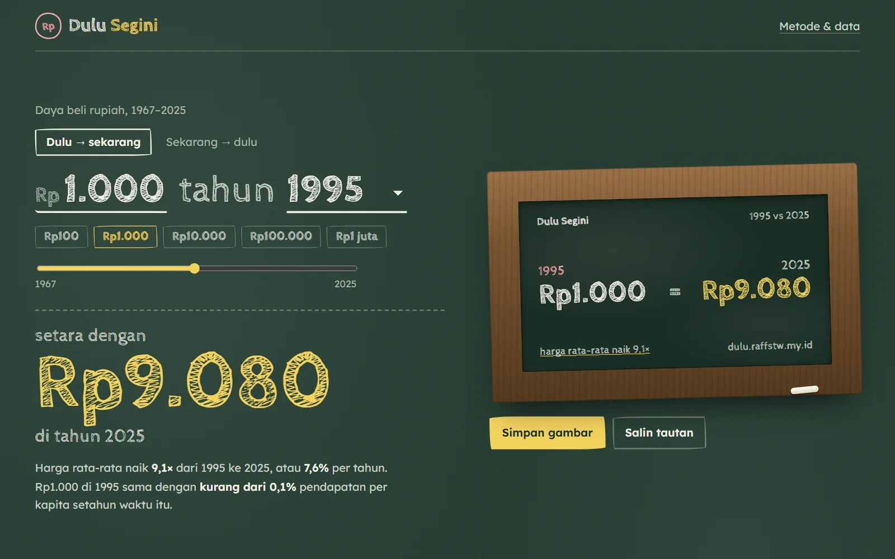</a>

### Dulu Segini
`Proyek Mandiri`

Uang saku Rp1.000 tahun 1995 itu setara berapa sekarang? Daya beli rupiah 1967–2025 dari Indeks Harga Konsumen, dua arah.

Plus tiga skenario: disimpan tunai, ditukar dolar, atau dibelikan emas. Data ditarik dari API World Bank, hasilnya bisa dibagikan sebagai kartu bergaya uang kertas lama.


[**Repo →**](https://github.com/Reverseflash45/dulu-segini) · [Hitung](https://dulu-segini.vercel.app)

</td>
<td width="50%" valign="top">

<a href="https://tebak-daerah.vercel.app">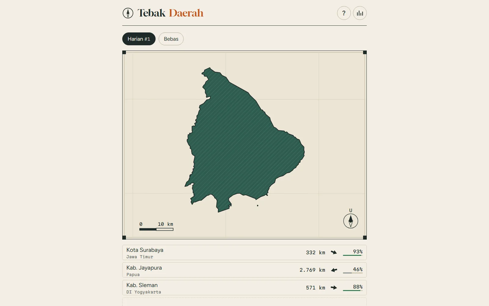</a>

### Tebak Daerah
`Proyek Mandiri`

Game ala Worldle: tebak satu dari 514 kabupaten & kota dari bentuk wilayahnya. Enam kesempatan, petunjuk jarak dan arah, soal harian yang sama untuk semua orang.

Batas wilayah disederhanakan per daerah supaya kota kecil tidak jadi segitiga; pengujian mencocokkan luas tiap bentuk dengan aslinya.


[**Repo →**](https://github.com/Reverseflash45/tebak-daerah) · [Main](https://tebak-daerah.vercel.app)

</td>
</tr>
<tr>
<td width="50%" valign="top">

<a href="https://getar.vercel.app">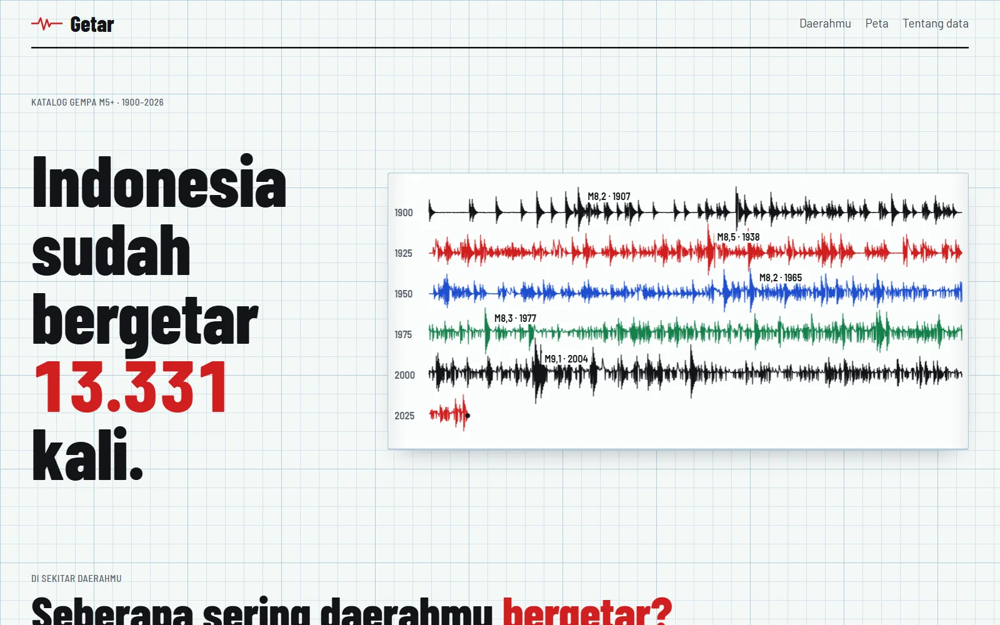</a>

### Getar
`Proyek Mandiri`

13 ribu lebih gempa M5+ di Indonesia sejak 1900 dari katalog USGS. Pilih kabupaten/kota, lihat berapa kali daerahmu diguncang dan gempa terkuatnya.

Seluruh katalog digambar sebagai pita seismogram dan peta yang memperlihatkan batas lempeng, plus hukum Gutenberg–Richter dari datanya sendiri.


[**Repo →**](https://github.com/Reverseflash45/getar) · [Buka](https://getar.vercel.app)

</td>
<td width="50%" valign="top">

<a href="https://bara-id.vercel.app">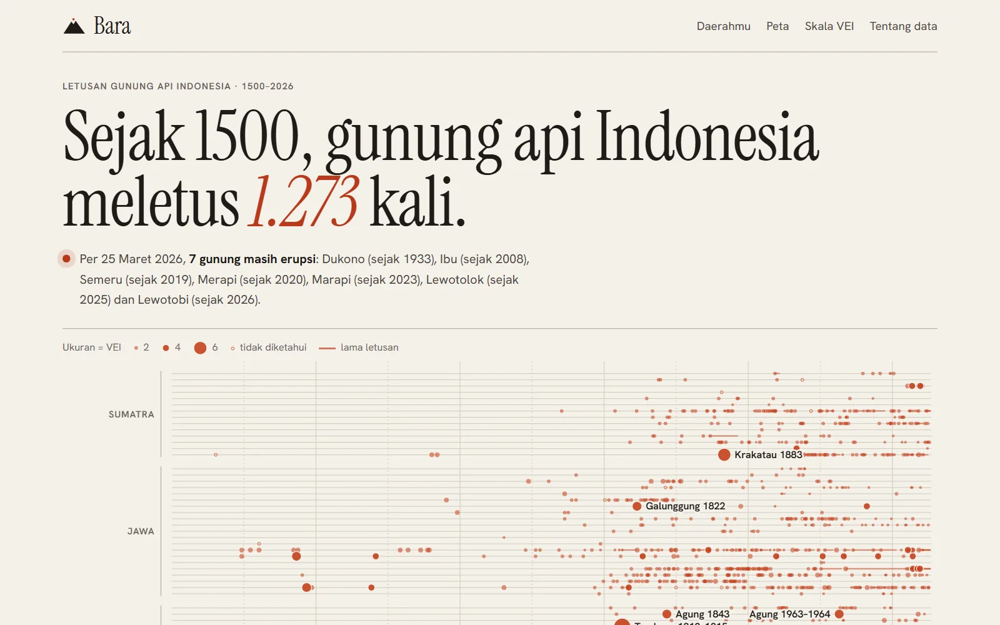</a>

### Bara
`Proyek Mandiri`

1.273 letusan gunung api Indonesia sejak 1500 dari data Smithsonian, satu baris per gunung dari Aceh sampai Halmahera. Cari gunung api terdekat dari kabupaten/kotamu.

Letusan yang masih berlangsung ditandai, termasuk Dukono yang erupsi terus sejak 1933. Plus skala VEI dan tiga raksasa: Samalas, Tambora, Krakatau.


[**Repo →**](https://github.com/Reverseflash45/bara) · [Buka](https://bara-id.vercel.app)

</td>
</tr>
<tr>
<td width="50%" valign="top">

<a href="https://bayang-id.vercel.app">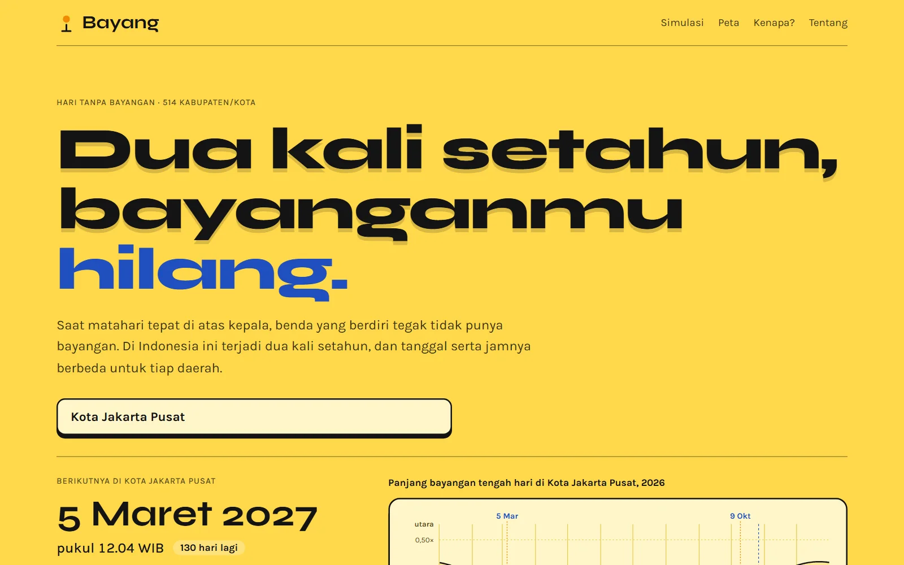</a>

### Bayang
`Proyek Mandiri`

Kapan matahari tepat di atas kepalamu? Tanggal dan jam hari tanpa bayangan untuk 514 kabupaten/kota, dihitung di peramban dari rumus posisi matahari.

Plus simulasi jam matahari tampak atas, peta tanggal dan jam terbit seluruh Indonesia, dan grafik kenapa terjadi dua kali setahun.


[**Repo →**](https://github.com/Reverseflash45/bayang) · [Buka](https://bayang-id.vercel.app)

</td>
<td width="50%" valign="top">

<a href="https://hilal-id.vercel.app">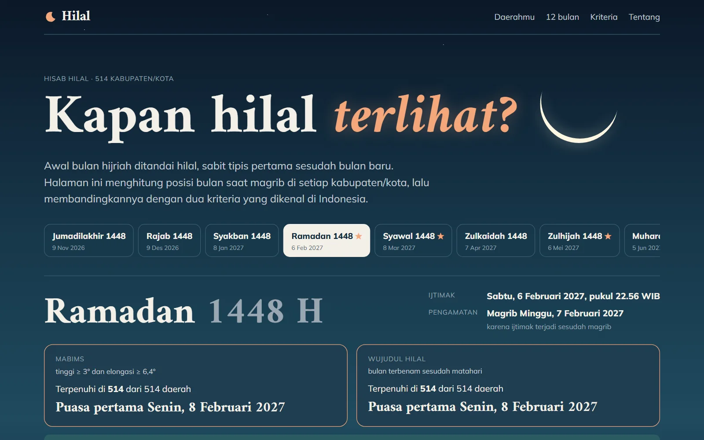</a>

### Hilal
`Proyek Mandiri`

Seberapa tinggi hilal di daerahmu saat magrib? Posisi bulan untuk 514 kabupaten/kota setelah tiap ijtimak, dibandingkan kriteria MABIMS dan wujudul hilal.

Perkiraan awal Ramadan, Idulfitri, dan Iduladha, plus diagram langit barat. Diuji terhadap perbedaan Idulfitri 2023 dan awal puasa 2024.


[**Repo →**](https://github.com/Reverseflash45/hilal) · [Buka](https://hilal-id.vercel.app)

</td>
</tr>
<tr>
<td width="50%" valign="top">

<a href="https://gending-id.vercel.app">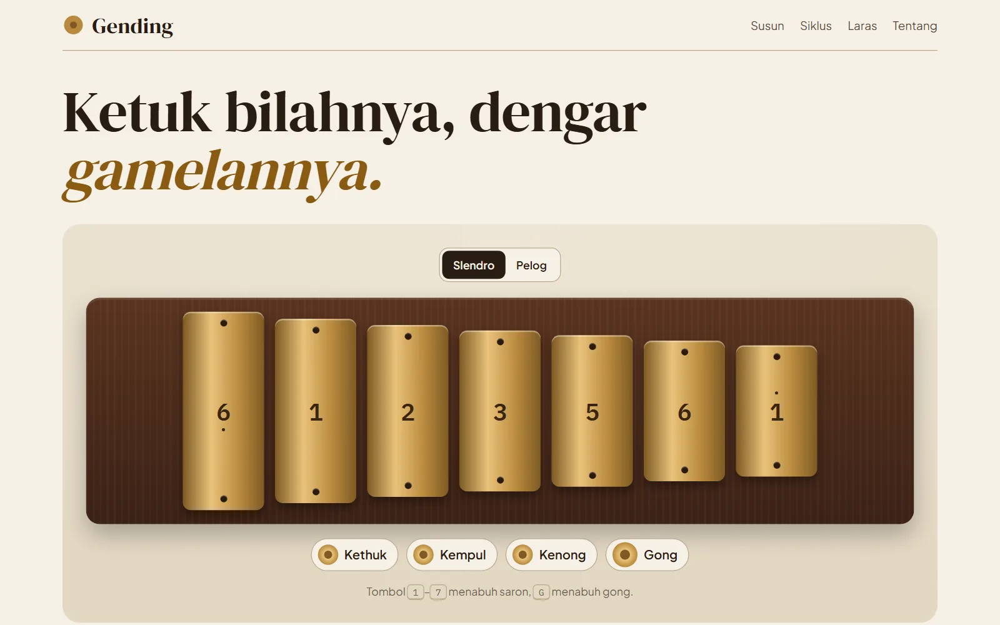</a>

### Gending
`Proyek Mandiri`

Gamelan Jawa di peramban: ketuk saron, tulis balungan dalam notasi kepatihan, dan dengar gong, kenong, kempul, serta kethuk jatuh di tempatnya untuk lancaran, ketawang, atau ladrang.

Semua bunyi disintesis dengan Web Audio, tanpa rekaman. Plus perbandingan laras slendro, pelog, dan piano.


[**Repo →**](https://github.com/Reverseflash45/gending) · [Main](https://gending-id.vercel.app)

</td>
<td width="50%" valign="top">

<a href="https://aksara-id.vercel.app">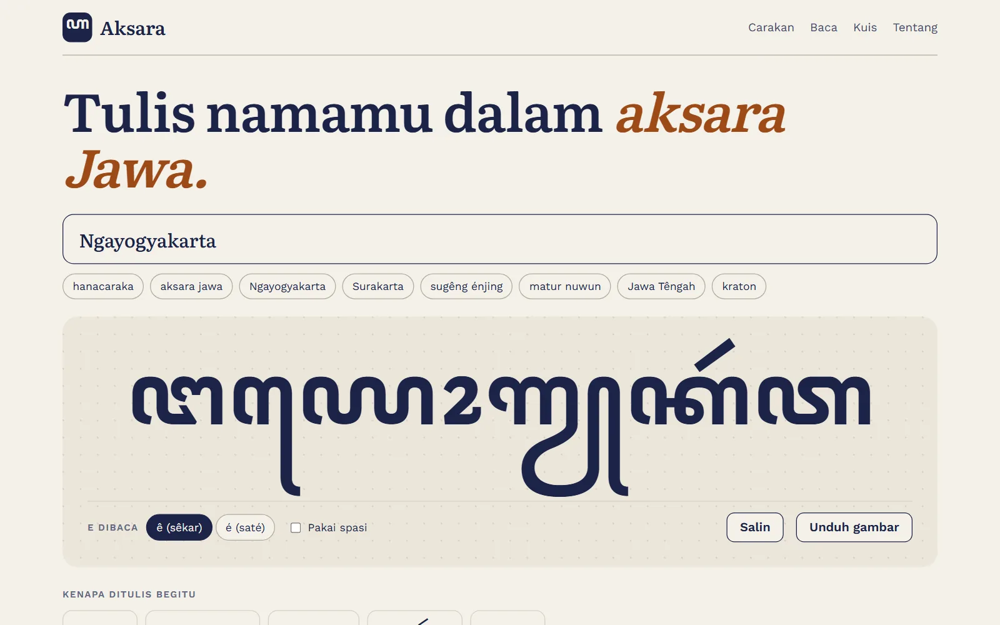</a>

### Aksara
`Proyek Mandiri`

Tulis namamu dalam aksara Jawa. Alih aksara Latin ⇄ hanacaraka dengan pasangan, sandhangan, dan catatan per suku kata yang menjelaskan kenapa ditulis begitu.

Plus carakan menurut kisah Aji Saka, kuis membaca, dan unduhan gambar.


[**Repo →**](https://github.com/Reverseflash45/aksara) · [Coba](https://aksara-id.vercel.app)

</td>
</tr>
<tr>
<td width="50%" valign="top">

<a href="https://lidah.vercel.app">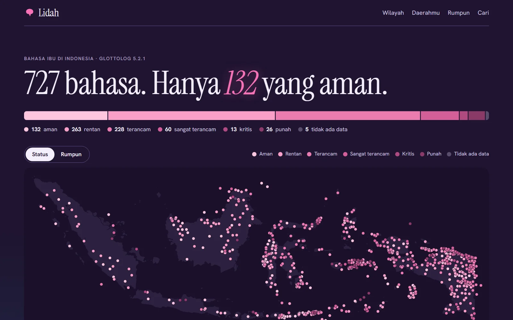</a>

### Lidah
`Proyek Mandiri`

727 bahasa ibu di Indonesia, hanya 132 yang aman. Peta setiap bahasa menurut status keterancaman dan rumpunnya, dari data Glottolog.

Plus komposisi per wilayah, bahasa terdekat dari kabupaten/kotamu, dan silsilah tiap bahasa.


[**Repo →**](https://github.com/Reverseflash45/lidah) · [Buka](https://lidah.vercel.app)

</td>
<td width="50%" valign="top">

<a href="https://lintas-id.vercel.app">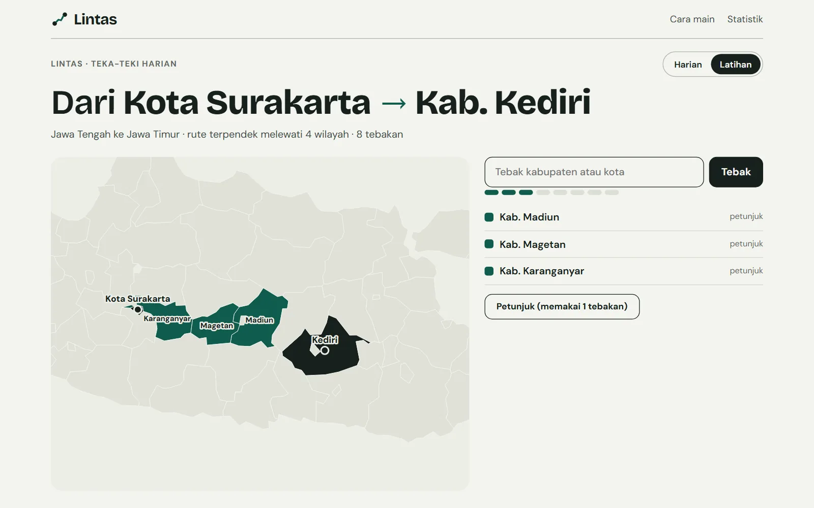</a>

### Lintas
`Proyek Mandiri`

Teka-teki geografi harian ala Travle: dua kabupaten/kota, tebak wilayah di antaranya sampai jalurnya tersambung lewat perbatasan darat.

Graf ketetanggaan dari topologi peta, rute terpendek dengan BFS, dan teka-teki yang sama untuk semua orang setiap hari.


[**Repo →**](https://github.com/Reverseflash45/lintas) · [Main](https://lintas-id.vercel.app)

</td>
</tr>
<tr>
<td width="50%" valign="top">

<a href="https://gerah.vercel.app">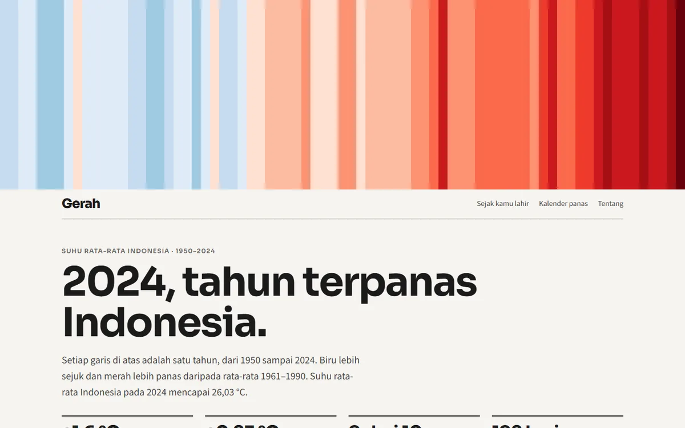</a>

### Gerah
`Proyek Mandiri`

Garis hangat Indonesia 1950–2024: 2024 tahun terpanas, dan 9 dari 10 tahun terpanas terjadi sejak 2015. Data ERA5 lewat World Bank CCKP.

Isi tahun lahirmu untuk melihat berapa derajat lebih gerah sejak itu, plus kalender panas 900 bulan.


[**Repo →**](https://github.com/Reverseflash45/gerah) · [Buka](https://gerah.vercel.app)

</td>
<td width="50%" valign="top">

<a href="https://gerhana-id.vercel.app">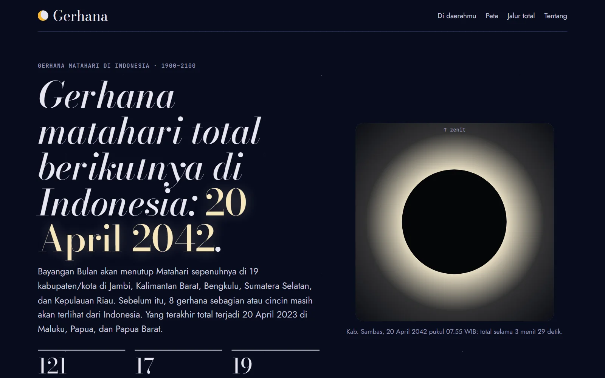</a>

### Gerhana
`Proyek Mandiri`

121 gerhana matahari yang terlihat dari Indonesia, 1900–2100, dihitung untuk 514 kabupaten/kota. Yang total berikutnya: 20 April 2042.

Jam dan lama gerhana di daerahmu, gambar Matahari dan Bulan yang bisa diputar, plus peta ketertutupan per gerhana.


[**Repo →**](https://github.com/Reverseflash45/gerhana) · [Buka](https://gerhana-id.vercel.app)

</td>
</tr>
</table>

<sub>Proyek kuliah lain: [WTOOLS](https://github.com/Reverseflash45/wtools-ui-workshop) (situs kebugaran, dari Figma sampai implementasi) · [RSHP](https://github.com/Reverseflash45/RSHP) (manajemen rumah sakit hewan pendidikan)</sub>

<br/>

<div align="center">


<br/><br/>

**rffernanditoo@gmail.com** · [raffstw.my.id](https://www.raffstw.my.id)

</div>
